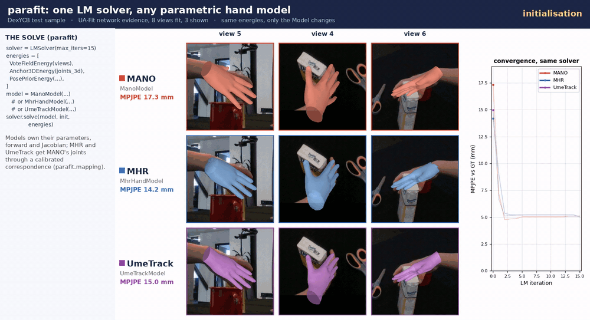

# parafit

**A pluggable analytical solver for parametric model fitting.**

`parafit` fits parametric models -- hands (MANO, MHR hand, UmeTrack), bodies (MHR),
and rigid or articulated objects -- to multi-view evidence with a batched, differentiable
Levenberg-Marquardt solver. Its **energies**, **models**, and **execution
backend** are all pluggable. It is the reusable solver core behind
[UA-Fit](https://marsilzakour.github.io/ua-fit/) (ECCV 2026 HANDS Workshop;
[code](https://github.com/MarsilZakour/ua-fit-code), [weights](https://huggingface.co/Marsil123/ua-fit)), released
standalone so new projects depend on one implementation instead of re-porting the same math.

<p align="center">
  
  <br>
  <em>One LMSolver, three hand models: MANO, MHR and UmeTrack fitted to the same UA-Fit network evidence (DexYCB test
  sample, 3 of 8 views) with the same energies; only the parafit Model changes.</em>
</p>

## What is in the box

| | |
|---|---|
| **Solver** | `LMSolver`: batched adaptive Levenberg-Marquardt (per-sample accept/reject, identity or Marquardt damping, float64 normal-equation solve by default) |
| **Models** | `ManoModel` (exact analytic Jacobian), `MhrModel` (Meta's Momentum Human Rig, pure torch, loads from a cache) and `MhrHandModel` (one MHR hand), `UmeTrackModel` (exact analytic Jacobian, per-segment rest shape), `TwoPartRevolute`, `RigidKeypointModel` |
| **Energies** | `ReprojectionEnergy`, `Anchor3DEnergy`, `PosePriorEnergy`, `JointLimitEnergy`; `ContactSDFEnergy` (stub) |
| **Mapping** | `parafit.mapping`: MANO's 21 joints on any articulated hand (MHR, UmeTrack), calibrated correspondence |


## Why

Three ideas, cleanly separated:

- **Models** (`parafit.models`) -- a parametric model owns its parameter layout,
  a differentiable forward (FK+LBS -> landmarks/verts), and an optional
  *analytic* Jacobian (autograd fallback otherwise).
- **Energies** (`parafit.energies`) -- each residual term contributes a
  Gauss-Newton block `(A, g, cost)`. Compose them explicitly; no global state.
- **Solver** (`parafit.LMSolver`) -- adaptive LM with per-sample accept/reject,
  swappable backend (torch now; CUDA / TensorRT planned via the fixed-iteration
  exportable path).

## Install

Core is torch-only; install from GitHub (PyPI release planned):

```bash
pip install "git+https://github.com/MarsilZakour/parafit.git"                # core solver + reprojection/anchor/pose-prior energies
pip install "parafit[mano] @ git+https://github.com/MarsilZakour/parafit.git"  # + MANO hand model
pip install "parafit[all] @ git+https://github.com/MarsilZakour/parafit.git"   # everything
```

Or for development:

```bash
git clone https://github.com/MarsilZakour/parafit.git
cd parafit && pip install -e ".[mano]"
```

With **uv** (recommended; resolves the git-only manotorch dep):

```bash
uv pip install "parafit[mano] @ git+https://github.com/MarsilZakour/parafit.git"
```

Install torch for your CUDA build first. MANO weights are not shipped (license):
point the loader at your local `mano_v1_2` assets.

## Quick start (core, no MANO needed)

```python
import torch
from parafit import LMSolver, ReprojectionEnergy, PinholeCameras
from parafit.models.example import RigidKeypointModel

model = RigidKeypointModel(canonical_points)          # (J,3)
cams = PinholeCameras(K, w2c)                          # (B,V,3,3), (B,V,4,4)
energy = ReprojectionEnergy(cams, target_uv)          # (B,V,J,2)
result = LMSolver(max_iters=15).solve(model, init_params, [energy])
print(result.params, result.diagnostics["final_cost"])
```

Run the end-to-end test (multi-view rigid fit + finite-difference Jacobian check):

```bash
python tests/test_core_overfit.py
```

## UmeTrack hand model

`UmeTrackModel` (`parafit.models.umetrack`, extra `[umetrack]`, pure torch -- no extra
dependencies) is a from-scratch FK+LBS port of
[facebookresearch/UmeTrack](https://github.com/facebookresearch/UmeTrack)'s hand model
(`lib/common/hand_skinning.py`) under the parafit `Model` interface: a 22-joint, 17-bone,
788-vertex hand skeleton with an exact analytic landmark Jacobian.

The hand-model json itself is **not vendored** (UmeTrack is released under
**CC-BY-NC 4.0**, non-commercial, incompatible with bundling into an MIT package). Get one
yourself and point `load_umetrack_hand` at it:

```bash
git clone https://github.com/facebookresearch/UmeTrack.git /tmp/UmeTrack
# generic (non-subject-specific) hand model, used by the upstream repo's own demos:
#   /tmp/UmeTrack/dataset/generic_hand_model.json
```

```python
from parafit.models.umetrack import load_umetrack_hand, UmeTrackModel

hand = load_umetrack_hand("/tmp/UmeTrack/dataset/generic_hand_model.json")
model = UmeTrackModel(hand, side="right")   # UmeTrack hand models are left hands; side="right" mirrors them
```

Per-subject profiles in the same json layout (e.g. a dataset's own
`profile_umetrack.json`, with the fields nested one level under a `"hand_model"` key)
load the same way -- `load_umetrack_hand` accepts both layouts. See
`parafit/models/umetrack.py`'s module docstring for the parameter layout, units
(metres internally; UmeTrack json files are millimetres), and the exact native-UmeTrack
-> OpenPose-21 landmark mapping. `model.articulation_limits` gives UmeTrack's joint limits (use them with
`JointLimitEnergy`), and `model.segment_scales` (5 fingers x [palm, proximal, middle, distal]) scales the rest
shape segment by segment, e.g. to match a subject's or another model's bone lengths.

## MANO-convention landmarks on other hands (`parafit.mapping`)

Hand networks trained on MANO predict MANO's 21 joints (16 mesh-regressed joints
+ 5 fingertip vertices, OpenPose order). To fit MHR or UmeTrack to such evidence,
`ManoConventionHand` attaches every MANO joint to one bone of the target hand with
a fixed offset (a `ManoCorrespondence`), applies the hand's shape (a uniform scale from
`hand_scale_between`, or UmeTrack's per-segment scales), and exposes the result as a regular parafit
`Model` with an exact Jacobian. The correspondence also maps every MANO vertex to
a barycentric point on the target mesh, so a fitted MHR / UmeTrack hand can be
scored against MANO ground truth vertex by vertex.

```python
from parafit.mapping import ManoConventionHand, ManoCorrespondence
from parafit.mapping.calibration import calibrate_mano_correspondence
from parafit.models.mano import ManoModel
from parafit.models.mhr import MhrModel
from parafit.models.mhr_hand import MhrHandModel

hand = MhrHandModel(MhrModel.from_cache("mhr_lod1_cache.pt"), side="right", full_mesh=True)
mano = ManoModel("assets/mano_v1_2", side="right")
corr = calibrate_mano_correspondence(hand, mano, "assets/mano_v1_2", "mhr_right")   # once; corr.save(...)
model = ManoConventionHand(hand, corr)          # landmarks = MANO joints on the MHR hand
```

Any hand that implements the small `ArticulatedHand` protocol (wrist-local bone
frames, native landmarks, mesh) can be wrapped; `MhrHandModel` and `UmeTrackModel`
do. Calibration fits the target to synthetic MANO hands (PCA pose prior, random
betas) within its joint limits, re-solves each joint's bone and offset in closed form,
and repeats; it reports the held-out residual as the representation gap between the two
models (MHR 2.1 mm, UmeTrack 3.2 mm mean joint distance). Ready-made correspondences ship with
[UA-Fit](https://github.com/MarsilZakour/ua-fit-code) (`assets/correspondences/`).

## Status

v0.1.0 -- the solver core (tensordict-batchable), the reprojection / 3D-anchor / pose-prior / joint-limit energies,
`ManoModel`, `MhrModel` / `MhrHandModel`, `UmeTrackModel` and the MANO correspondence (`parafit.mapping`) are
implemented and tested; `ContactSDFEnergy` is an interface stub. In use as the solver of
[UA-Fit](https://github.com/MarsilZakour/ua-fit-code). Roadmap: multi-body scenes (hand + object), CUDA / TensorRT
backend. Design notes: `docs/parafit-library-design.md`.

## License

MIT.
